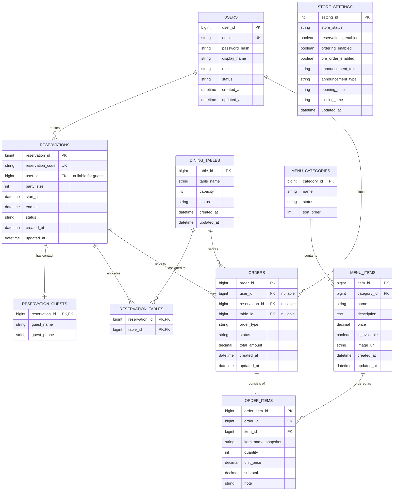

# 資料庫實體關聯圖 (ER Diagram) 與資料字典

依據 [SPEC.md](SPEC.md) 第 7 節之資料庫規格與 [schema.sql](schema.sql)。

## 1. 實體關聯圖 (ER Diagram)

---

## 2. 核心約束與規則說明

1. **訪客預約機制**：
   - 若為未註冊訪客，`reservations.user_id` 為 `NULL`。
   - 訪客預約時，必須同時寫入 `reservation_guests`，記錄姓名與電話。
2. **多桌與自動分配**：
   - 第一版自動分配策略僅分配單一合適桌位，寫入一筆 `reservation_tables`。
   - 透過 `reservation_tables` 關聯表保留未來多桌合併（REQ-P2）的擴充能力。
3. **歷史訂單金額保護 (Snapshot Pattern)**：
   - `order_items` 必須寫入當時的 `item_name_snapshot` 與 `unit_price`。
   - 菜單價格變動或餐點下架（`is_available = 0`）不得影響已成立之歷史訂單。
4. **金額型態**：
   - 統一使用 `DECIMAL(10, 2)`，避免浮點數誤差。
